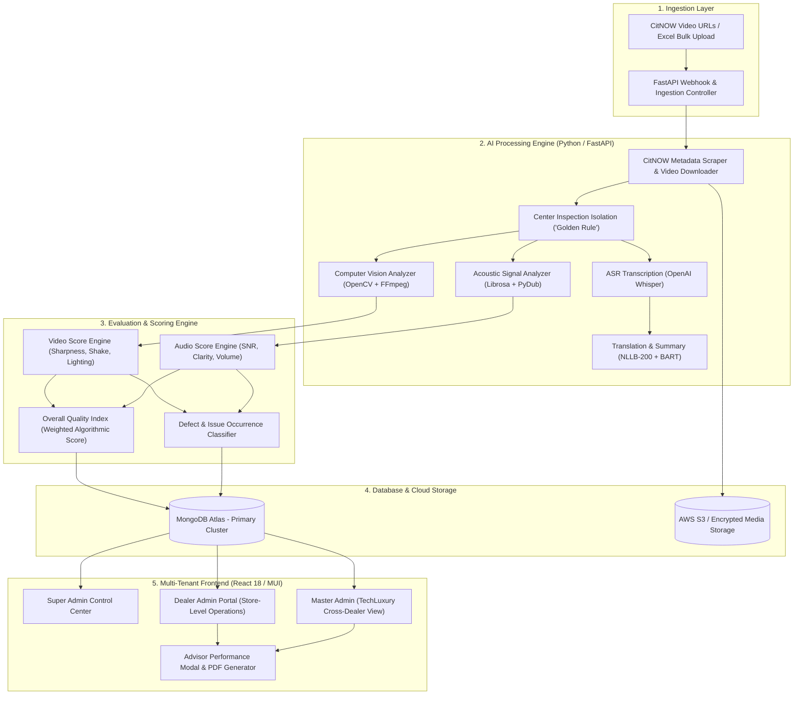

# 🔍 QualityLens — AI-Powered Video & Audio Quality Inspection Platform

[]()
[]()
[]()
[]()

---

## 📖 1. Project Overview

**QualityLens** (CitNOW Quality Lens) is an enterprise-grade, cloud-native AI inspection and intelligence platform designed specifically for luxury automotive dealership networks and authorized service centers (supporting BMW, MINI, and multi-brand networks).

Vehicle service advisors and technicians routinely record walkaround inspection videos via CitNOW to explain repair estimates, vehicle wear, tire conditions, and brake health directly to vehicle owners. In the automotive industry, video presentation quality directly drives customer trust, transparency, and high repair authorization rates.

**QualityLens** automates the end-to-end quality assurance of these inspection recordings. By ingesting CitNOW video streams, the platform extracts technical video signals, acoustic parameters, and speech transcripts to compute standardized quality scores, pinpoint recurring presentation issues, and benchmark service advisors and dealerships network-wide.

---

## 🎯 2. Core Value Proposition & Business Impact

| Strategic Goal | Dealership Challenge | How QualityLens Solves It |
| :--- | :--- | :--- |
| **Customer Conversion & Trust** | Shaky footage, poor workshop lighting, or inaudible speech lead to customer skepticism and rejected repair estimates. | Evaluates clarity, framing, lighting, and audio intelligibility to ensure every video meets luxury brand standards. |
| **Advisor Coaching & Accountability** | Service managers lack the time to manually watch hundreds of 2-to-3 minute walkaround videos each week. | Automatically produces advisor scorecards, ranking top-performing advisors and flagging specific recurring defects (e.g. camera shake, background noise). |
| **Network-Wide Governance** | Multi-branch dealership groups have no consolidated visibility into branch-by-branch video quality performance. | Provides multi-tenant dashboards with dynamic dealer-wise filtering, trend analytics, and cross-dealer benchmarking. |
| **Multilingual Transparency** | Technicians frequently speak regional vernacular languages, while customers or audits require standard English. | Employs AI transcription (OpenAI Faster-Whisper) and neural machine translation (NLLB-200) into clean English summaries. |

---

## 🏗️ 3. High-Level System Architecture



---

## ⚡ 4. Comprehensive Feature Breakdown

### 4.1. Intelligent Video Quality Analysis (Computer Vision)
- **Center Inspection Isolation ("Golden Rule")**:
  - Automatically detects and skips static dealership branding intro bumpers (e.g., first 5–8 seconds) and promotional outro cards.
  - Focuses video quality evaluation exclusively on the technician's actual vehicle inspection window.
- **Laplacian Variance Sharpness Detection**:
  - Evaluates lens focus across extracted keyframes.
  - Flags blurry lenses caused by grease or improper macro-focus when showing tire treads or brake discs.
- **Optical Flow Camera Shake & Stability Analysis**:
  - Measures inter-frame motion vectors using Farneback optical flow.
  - Categorizes excessive panning speeds, abrupt tilts, and walking vibration.
- **Exposure, Contrast & Under-lighting Diagnostics**:
  - Analyzes RGB/HSV histogram distribution to detect dark under-chassis inspections or glaring outdoor reflections.
- **Compression Blockiness & Bitrate Check**:
  - Monitors compression artifacts, macroblocking, and pixelation in low-bandwidth uploads.

---

### 4.2. Acoustic Signal Processing & Speech Intelligence (Audio Engine)
- **Spectral Signal-to-Noise Ratio (SNR) Estimation**:
  - Utilizes Librosa spectral decomposition to distinguish technician speech from pneumatic impact wrenches, exhaust noise, and workshop echo.
- **RMS Volume Normalization & Inaudibility Flags**:
  - Detects low technician speech volume, muffled microphone placement, or clipped audio.
- **Zero-Commentary & Silence Penalties**:
  - Accurately penalizes inspection videos recorded without spoken commentary, preventing artificial high scores for silent videos.
- **Speech-to-Text Transcription (Faster-Whisper)**:
  - Generates full time-coded transcripts of technician explanations.
- **Multilingual Neural Translation (Meta NLLB-200 & MarianMT)**:
  - Seamlessly translates regional technician vernacular (e.g., Hindi, Tamil, Telugu, Marathi, Kannada) into professional English.
- **Executive Summary Synthesis (BART-large-CNN)**:
  - Condenses 3-minute technical commentary into a 2-sentence executive vehicle health summary.

---

### 4.3. Advisor Performance Diagnostics & Issue Tracking
- **Individual Advisor Scorecards**:
  - Tracks individual service advisors across overall score, video score, audio score, and historical video volume.
- **Detected Issues Alone with Occurrence Badging**:
  - Advisor popups strictly surface detected areas of technical refinement accompanied by exact occurrence counts:
    - 📹 **Video Quality / Lighting & Camera Shake** (`X Occurrences`)
    - 🎙️ **Audio Clarity & Background Noise Interference** (`X Occurrences`)
    - 📋 **Inspection Presentation Consistency** (`X Occurrences`)
  - Eliminates misleading generic ratings, giving managers clear coaching insights.
- **Personalized Advisor Video History Filtering**:
  - One-click navigation to view the complete catalog of videos recorded by a specific advisor.

---

### 4.4. Multi-Tenant Role-Based Dashboards & Dealer-Wise Filtering
- **Dealer-Wise Analytics Filter**:
  - A dynamic dropdown across all analytics views allowing executives to view aggregated network performance or isolate a single dealership (e.g., *Bird Automotive Private Limited*, *Zenica Performance Cars*, *Krishna Automotive*).
- **Network Performance Benchmarking**:
  - Live network average quality score tracking (baseline target: **7.4 / 10**).
  - Dynamic classification into *Excellent (8.5–10.0)*, *Good (7.0–8.4)*, *Needs Attention (5.0–6.9)*, and *Critical (< 5.0)*.
- **Multi-Role User Hierarchy**:
  - **Super Admin**: Manages tenant dealerships, user accounts, system configuration, and network-wide analytics.
  - **Master Admin (TechLuxury)**: Cross-dealer quality monitoring, brand compliance tracking, and executive reporting.
  - **Dealer Admin**: Manages branch-level service advisors, video logs, and store performance trends.
  - **Service Advisor**: Views individual video ratings, customer feedback, and personalized coaching guidance.

---

### 4.5. High-Throughput Bulk Processing & Ingestion
- **Excel Batch Upload**:
  - Upload spreadsheets containing hundreds of CitNOW links, registration numbers, customer names, and technician assignments.
- **Asynchronous Task Queuing**:
  - Multi-threaded processing pipeline with configurable concurrency limits and thread workers optimized for high-spec cloud hardware (e.g., 8-core CPU instances).
- **Automated CitNOW DOM Scraper**:
  - Extracts CitNOW service advisor names, dealership branch, vehicle registration numbers, and creation timestamps directly from web links.

---

### 4.6. PDF & Executive Reporting
- **Branded Executive PDF Export**:
  - Generates comprehensive PDF inspection audit reports with embedded quality charts, score distributions, and technician recommendations.
- **CSV Data Export**:
  - Instant export of analyzed datasets for dealer management systems (DMS) and BI integrations.

---

## 📊 5. Quality Scoring Model & Formulas

The platform calculates a composite **Overall Quality Score** ($S_{\text{overall}}$) out of 10.0 based on weighted technical video and acoustic metrics:

```math
S_{\text{overall}} = (w_v \times S_{\text{video}}) + (w_a \times S_{\text{audio}}) + \text{Penalties}
```

### Video Quality Score ($S_{\text{video}}$) — Weight: 50%
| Component | Metric | Optimal Range | Impact |
| :--- | :--- | :--- | :--- |
| **Sharpness** | Laplacian Variance | $\ge 250$ | Penalizes blurriness or out-of-focus camera work. |
| **Stability** | Optical Flow Vector Std. Dev. | Low variance | Penalizes sudden jerking, rapid panning, or excessive shake. |
| **Illumination** | Mean Pixel Luminance & Entropy | $85 - 180$ | Flags pitch-black undercarriage or overexposed sunlight glare. |
| **Framing** | Vehicle Centering Ratio | $\ge 70\%$ | Measures whether vehicle components stay centered in frame. |

### Audio Quality Score ($S_{\text{audio}}$) — Weight: 50%
| Component | Metric | Optimal Range | Impact |
| :--- | :--- | :--- | :--- |
| **Clarity** | Spectral SNR | $\ge 16 \text{ dB}$ | Distinguishes voice from background garage machinery noise. |
| **Volume Level** | RMS Energy | $-24 \text{ dBFS}$ to $-14 \text{ dBFS}$ | Penalizes quiet/inaudible whisper or distorted clipping. |
| **Voice Continuity**| Voice Activity Detection (VAD) | $\ge 60\%$ speech | Flags long silent pauses or lack of spoken explanation. |
| **Zero Commentary**| Silent Video Check | Speech $> 5 \text{ sec}$ | Silent videos receive a capped audio score ($\le 3.0$). |

---

## 💻 6. Technology Stack Summary

```text
├── Backend API & Engine
│   ├── Language: Python 3.10+
│   ├── Web Framework: FastAPI (Async Uvicorn ASGI)
│   ├── Computer Vision: OpenCV 4.9, FFmpeg, NumPy
│   ├── Audio Signal Processing: Librosa, PyDub, SciPy, SoundFile
│   ├── AI Transcription: OpenAI Faster-Whisper
│   ├── Machine Translation: Meta NLLB-200, HuggingFace Transformers
│   ├── Database Driver: Motor / PyMongo (MongoDB Atlas)
│   └── Validation: Pydantic v2
│
├── Frontend Application
│   ├── Framework: React 18
│   ├── UI Design System: Material UI (MUI v5)
│   ├── Data Visualization: Recharts
│   ├── Routing: React Router v6
│   ├── HTTP Client: Axios
│   └── Export Engine: jsPDF, html2canvas
│
└── Infrastructure & DevOps
    ├── Server: AWS EC2 Ubuntu (8 vCPU / 16 GB RAM)
    ├── Reverse Proxy & TLS: Caddy Server (Automated HTTPS)
    ├── Containerization: Docker & Docker Compose
    ├── Registry: AWS Elastic Container Registry (ECR)
    └── CI/CD: GitHub Actions (.github/workflows/deploy-aws.yml)
```

---

## 📁 7. Repository Structure

```text
Quality_Lens/
├── backend/
│   ├── main.py                     # Primary FastAPI application entrypoint & routing
│   ├── config.py                   # Environment configuration & concurrency limits
│   ├── models.py                   # Pydantic schemas and database models
│   ├── video_processor.py          # OpenCV video metric analysis & frame sampling
│   ├── audio_processor.py          # Librosa audio metrics, SNR, and RMS computation
│   ├── whisper_transcriber.py      # Faster-Whisper ASR pipeline
│   ├── translation_service.py      # Meta NLLB multilingual translation
│   ├── summarizer.py               # BART executive summary generator
│   └── database.py                 # MongoDB Atlas connection manager
│
├── frontend/
│   ├── public/                     # Static assets, branding, and index.html
│   └── src/
│       ├── App.js                  # Route definitions and authentication provider
│       ├── pages/
│       │   ├── dealer-admin/       # Dealer Admin operational portal & advisor modals
│       │   ├── master-admin/       # TechLuxury master overview & dealer comparisons
│       │   └── super-admin/        # Super Admin multi-tenant management
│       ├── components/             # Reusable UI widgets, charts, and file uploaders
│       ├── services/               # API clients for video, analytics, and auth
│       └── utils/                  # Formatting helpers, color scales, and calculators
│
├── .github/
│   └── workflows/
│       └── deploy-aws.yml          # Automated CI/CD deployment pipeline to AWS EC2
│
├── PROJECT_TECHNICAL_DOCUMENTATION.md # Detailed algorithmic and pipeline specs
├── PROJECT_OVERVIEW_AND_FEATURES.md  # Comprehensive project and feature reference
└── README.md                       # Quickstart developer guide
```

---

## 🔒 8. Security & Data Protection

- **Role-Based Access Control (RBAC)**: Strict segregation between Super Admin, Master Admin, Dealer Admin, and Service Advisors.
- **JWT Authentication**: Secure stateless authentication with SHA-256 encrypted tokens.
- **CORS Protection**: Restricted HTTP origins ensuring APIs are accessible solely by authorized frontends.
- **Cloud Media Security**: Temporary pre-signed storage handles preventing unauthorized direct file access.
- **Automated SSL/TLS**: Production endpoints served over HTTPS via Caddy reverse proxy with automated Let's Encrypt certificates.
